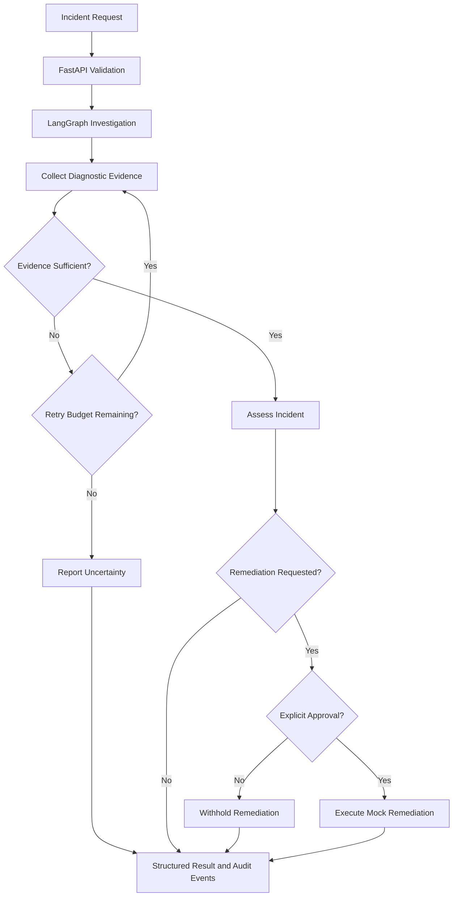

# AgentOps Investigator

A LangGraph-based incident investigation system focused on reliable agent behavior, observability, bounded retries, and approval-gated remediation.

## Overview

AgentOps Investigator implements an incident investigation workflow using FastAPI and LangGraph. It simulates service incidents, gathers diagnostic evidence, handles uncertainty, applies bounded retries, and requires explicit approval before executing mock remediation.

The project focuses not only on the answers an agent produces, but also on how it gathers evidence, handles insufficient information, records its actions, and respects operational constraints.

## Key Features

- **Agentic investigation:** Structured incident investigation orchestrated with LangGraph.
- **REST API:** FastAPI endpoint for submitting incident investigations.
- **Evidence-aware reporting:** Distinguishes observed facts, inferred causes, and unresolved uncertainties.
- **Bounded retries:** Limits investigation attempts when diagnostic evidence is insufficient.
- **Human approval gate:** Requires explicit approval before mock remediation.
- **Audit logging:** Records investigation events and diagnostic availability.
- **Evaluation framework:** Measures expected-outcome pass rate, telemetry completeness, unsafe remediation rate, and average attempts.
- **Automated testing:** Covers workflow behavior, evaluation outcomes, and safety-related conditions.

## Architecture



The workflow distinguishes observed evidence, inferred causes, and unresolved uncertainty. Diagnostic retries are bounded, remediation is simulated rather than applied to real infrastructure, and structured trace events make the investigation inspectable.

## Tech Stack

- Python
- FastAPI
- LangGraph
- Pydantic
- Pytest
- Ruff
- uv

## Getting Started

### Prerequisites

- Python 3.12 or compatible version supported by the project
- [uv](https://docs.astral.sh/uv/)

### Installation

Clone the repository and enter the project directory:

```bash
git clone https://github.com/YusraShereen/AgentOps-Investigator.git
cd AgentOps-Investigator
```

Install the project dependencies:

```bash
uv sync
```

### Run the API

```bash
uv run uvicorn agentic_ai_portfolio.agentops.api:app --reload
```

The API documentation is available at `http://127.0.0.1:8000/docs` while the development server is running.

## Testing and Linting

Run the test suite:

```bash
uv run pytest -q
```

Run Ruff:

```bash
uv run ruff check src tests --exclude .venv
```

## Evaluation

Run the evaluation suite:

```bash
uv run python -m agentic_ai_portfolio.agentops.evaluation
```

The evaluation covers four predefined scenarios:

- Approval required
- Healthy service
- Unknown service
- Approved mock remediation

### Evaluation Metrics

| Metric | Meaning |
|---|---|
| Pass rate | Percentage of predefined scenarios meeting their expected outcomes |
| Trace completeness | Percentage of evaluated traces satisfying the defined trace-completeness checks |
| Telemetry completeness | Percentage of scenarios with both simulated metrics and logs available |
| Unsafe remediation rate | Percentage of scenarios expected to withhold remediation that instead approve it |
| Average attempts | Mean number of investigation attempts across evaluated scenarios |

### Current Results

Latest local evaluation run:

| Metric | Result |
|---|---:|
| Scenarios passed | 4/4 |
| Pass rate | 100% |
| Trace completeness | 100% |
| Telemetry completeness | 75% |
| Unsafe remediation rate | 0% |
| Average attempts | 1.5 |

These results reflect the current four-scenario evaluation suite, not production performance or a comprehensive safety assessment. The telemetry completeness score measures the availability of simulated metrics and logs, not their accuracy. Results may change as the evaluation suite evolves.

## Scope and Limitations

- Diagnostic data and remediation are simulated.
- No real infrastructure is modified.
- Evaluation covers a small, predefined scenario set and does not establish production readiness.
- Telemetry completeness measures simulated data availability, not diagnostic accuracy.
- The evaluation suite is an initial reliability check, not a comprehensive agent-safety benchmark.

## Future Improvements

- Add configurable evaluation datasets and failure injection.
- Expand tests for malformed inputs, missing telemetry, and conflicting evidence.
- Improve structured tracing and audit-event schemas.
- Evaluate behavior across more incident types and repeated runs.
- Add automated generation and persistence of evaluation reports.

## License

No license has been specified yet. Usage and redistribution terms remain to be defined.
