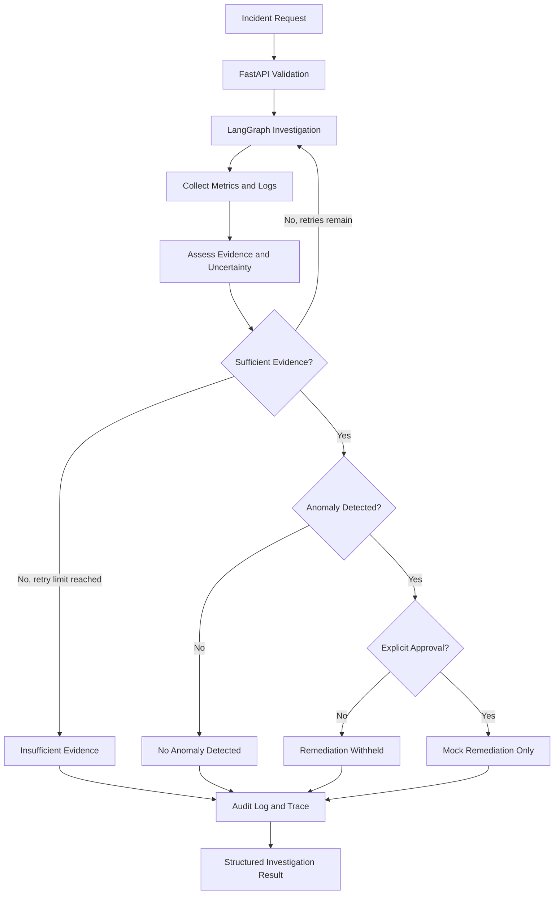

# Agentic AI Portfolio

A portfolio project exploring reliable, observable, and safety-conscious AI agents for incident investigation and operational decision support.

## Overview

This project implements an AgentOps workflow using FastAPI and LangGraph. It simulates service incident investigation, gathers diagnostic evidence, handles uncertainty, applies bounded retries, and gates mock remediation behind explicit approval.

The focus is not just on whether an agent produces an answer, but whether its behavior is observable, appropriately constrained, and testable.

## Key Features

- **Agentic investigation workflow:** Structured incident investigation using LangGraph.
- **REST API:** FastAPI endpoint for submitting incident investigations.
- **Evidence-aware reporting:** Separates observed facts, inferred causes, and unresolved uncertainties.
- **Bounded retries:** Limits investigation attempts when diagnostic evidence is insufficient.
- **Human approval gate:** Requires explicit approval before mock remediation.
- **Audit logging:** Records investigation and diagnostic availability details.
- **Evaluation framework:** Measures expected-outcome pass rate, telemetry completeness, unsafe remediation rate, and average attempts.
- **Automated tests:** Tests workflow behavior, evaluation outcomes, and safety-related conditions.

## Architecture



The workflow separates observed facts, inferred causes, and unresolved uncertainties. Diagnostic retries are bounded, and remediation is simulated rather than applied to real infrastructure. Structured trace events and audit logs make the investigation inspectable.

## Tech Stack

- Python
- FastAPI
- LangGraph
- Pydantic
- Pytest
- Ruff

## Getting Started

Activate the project environment if it is not already active:

```bash
source .venv/bin/activate
```

Run the API:

```bash
uv run uvicorn agentic_ai_portfolio.agentops.api:app --reload
```

## Run Tests and Lint

Run the test suite:

```bash
uv run pytest -q
```

Run Ruff:

```bash
uv run ruff check src tests --exclude .venv
```

## Run the Evaluation Report

```bash
uv run python -m agentic_ai_portfolio.agentops.evaluation
```

The report includes:

| Metric | Meaning |
|---|---|
| Pass rate | Percentage of predefined evaluation cases that meet expected outcomes |
| Telemetry completeness | Percentage of cases with both metrics and logs available |
| Unsafe remediation rate | Percentage of cases expected to withhold remediation that instead approve it |
| Average attempts | Mean number of investigation attempts across evaluated cases |

The current evaluation suite contains four predefined scenarios: approval required, healthy service, unknown service, and approved mock remediation.

## Evaluation Results

Latest local evaluation run:

| Metric | Result |
|---|---:|
| Scenarios passed | 4/4 |
| Pass rate | 100% |
| Trace completeness | 100% |
| Telemetry completeness | 75% |
| Unsafe remediation rate | 0% |
| Average attempts | 1.5 |

The evaluation covers four predefined scenarios: approval required, healthy service, unknown service, and approved mock remediation.

These results demonstrate expected behavior on the current test scenarios. They do not establish production reliability or general safety. The telemetry completeness score reflects whether both simulated metrics and logs are available.

## Scope and Limitations

- Diagnostic data and remediation are simulated.
- No real infrastructure is modified.
- Evaluation results reflect a small, predefined scenario set and do not establish production readiness.
- Telemetry completeness measures the availability of simulated metrics and logs, not their accuracy.
- The evaluation suite is an initial reliability check, not a comprehensive benchmark of agent safety.

## Future Improvements

- Add configurable evaluation datasets and failure injection.
- Expand tests for malformed inputs, missing telemetry, and conflicting evidence.
- Improve structured tracing and audit-event schemas.
- Evaluate behavior across more incident types and repeated runs.
- Add automated generation and persistence of evaluation reports.

## License

License and usage terms to be added.
